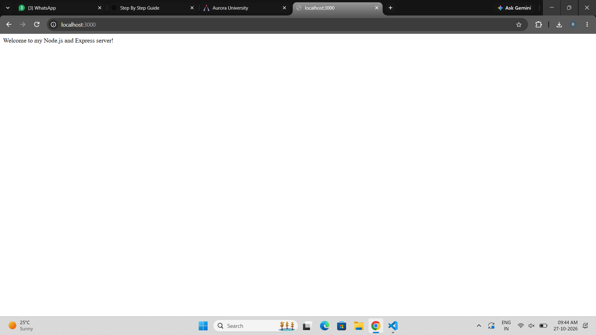
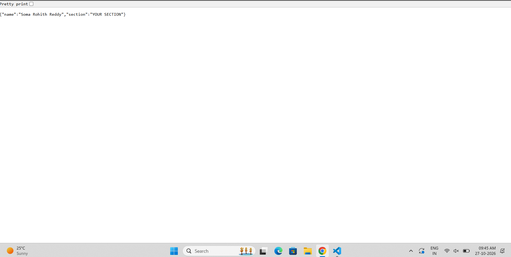
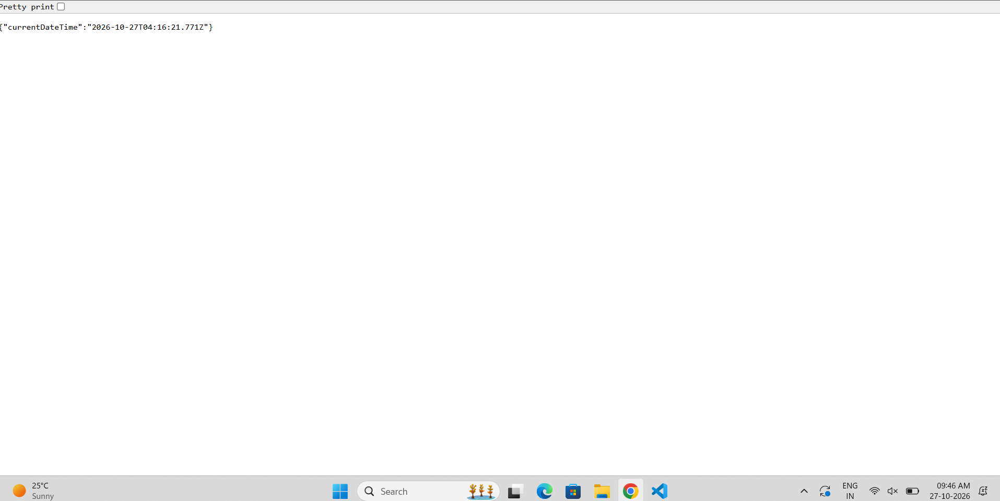
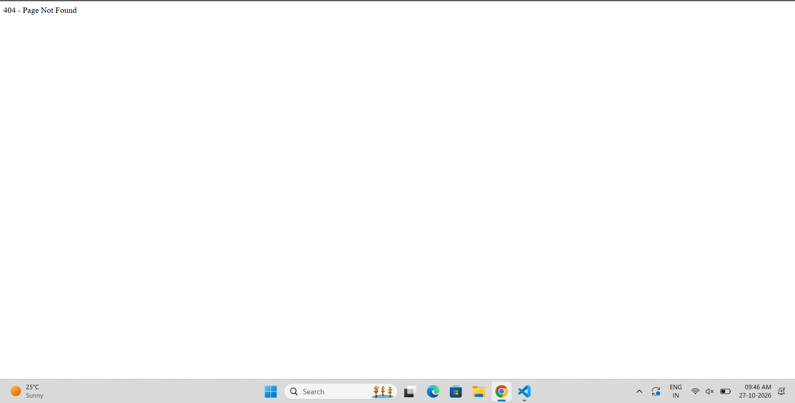

# Lab 1: Node.js and Express Server

## Student Details
- Name: Soma Rohith Reddy
- Registration Number: Enter your registration number
- Section: Enter your section

## Objective
To create a web server using Node.js and Express and handle HTTP requests using different routes.

## Technologies Used
- Node.js
- Express.js
- JavaScript

## How to Run
1. Install Node.js.
2. Open the project folder in the terminal.
3. Install dependencies by running `npm install`.
4. Start the server using `node server.js`.
5. Open `http://localhost:3000` in your browser.

## Endpoints

| Method | Path | Description |
|---|---|---|
| GET | `/` | Displays a welcome message |
| GET | `/about` | Returns the student's name and section |
| GET | `/time` | Returns the current date and time |
| GET | Unknown paths | Returns a 404 error message |

## Screenshots

### Home Route

### About Route

### Time Route

### Not Found Route

## Conclusion
Successfully created and tested a Node.js and Express server with three routes and a 404 error handler.